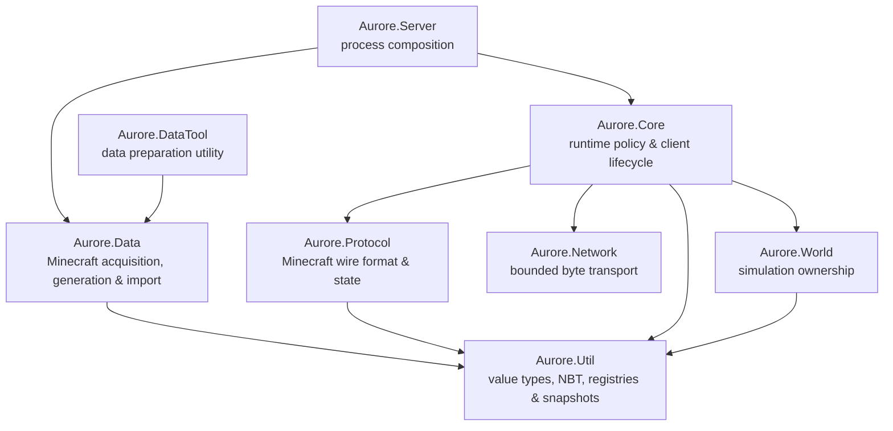

<div align="center">

# Aurore

### A modern C++ Minecraft server built from the wire up.

**Protocol-first · Explicit ownership · Bounded resources · Deterministic state**

[](https://github.com/ZettaBite4031/Aurore/actions/workflows/ci.yml)


[](LICENSE.txt)

**Windows x64 · Linux x86-64 · CMake-first**

*A ZettaTech Systems project.*

</div>

> [!WARNING]
> Aurore is not playable yet. It is active pre-alpha systems work, not a production Minecraft server.

> [!IMPORTANT]
> Aurore is an independent project. It is not an official Minecraft product and is not approved by or associated with Mojang Studios or Microsoft.

---

## The short version

Aurore is a from-scratch Minecraft-compatible server written in modern C++.

There is no vanilla server hiding underneath it and no large framework quietly doing the interesting parts. Networking, protocol state, registry synchronization, client lifecycle, world ownership, and eventually gameplay are being built as explicit systems with testable boundaries.

The current compatibility target is **Minecraft: Java Edition 1.21.11 / protocol 774**.

The first major protocol frontier is now complete:

> **An unmodified vanilla 1.21.11 client can connect to Aurore, complete Configuration using real generated vanilla registry data, send serverbound Finish Configuration, and be formally admitted by Core into Play.**

That does **not** mean the server is playable yet. Aurore currently stops at the Play boundary. The next work is the minimum valid Play bootstrap and the beginning of **First Light**.

---

## Current frontier

```text
 HANDSHAKE          STATUS             LOGIN          CONFIGURATION             PLAY
    READY             READY             READY             READY              NEXT FRONTIER
      ●─────────────────●─────────────────●─────────────────●────────────────────◐
                                                                                │
                                                                     minimum Play bootstrap
```

Aurore can currently:

- complete Handshake and Status with an unmodified vanilla 1.21.11 client;
- complete offline Login and Core identity admission;
- enter Configuration and retain Client Information and client brand data;
- send Feature Flags and negotiate Known Packs;
- defer registry materialization until the client's Known Packs response;
- prepare authoritative Minecraft 1.21.11 data from the official server artifact;
- import that generated corpus into an immutable, generation-tracked registry snapshot;
- send real Registry Data and Update Tags derived from the imported vanilla corpus;
- send clientbound Finish Configuration;
- receive vanilla's serverbound Finish Configuration acknowledgement;
- transition the protocol session and Core lifecycle from Configuration into Play;
- formally recognize the admitted identity as a joined player.

The current intentional stopping point is **Play admission**. Aurore does not yet send the Play-state bootstrap required to place the player into a world, so a vanilla client will not remain in a playable session after the transition.

That is now the next frontier.

---

## The production data path

Aurore's production server no longer depends on the synthetic registry snapshot.

The normal startup path is:

```text
        Mojang version metadata
                  │
                  ▼
        official server artifact
                  │
          SHA-1 verification
                  │
                  ▼
      Minecraft data generation
                  │
       content-addressed cache
                  │
                  ▼
      validated generated corpus
                  │
                  ▼
       VanillaDataImporter
                  │
                  ▼
       immutable RegistrySnapshot
                  │
                  ▼
       Core::ServerBootstrap
                  │
                  ▼
      protocol-774 Configuration
                  │
                  ▼
           vanilla client
```

Generated data is keyed by the server artifact SHA-1. A complete existing generation is validated and reused on later launches instead of being regenerated every time. Partial or invalid generation output is replaced.

For development and convergence testing, an already generated corpus can also be supplied directly through:

```text
AURORE_MINECRAFT_DATA_ROOT
```

The checked-in synthetic registry factory still exists as a deterministic test fixture. It is no longer the normal production startup source.

---

## Vanilla registry import

`Aurore.Data` now translates the Minecraft 1.21.11 generated corpus into Aurore's normalized registry model before networking opens.

The importer currently covers:

- typed block and item identity registries using Mojang protocol IDs;
- typed dimension type and biome registries;
- all **23 protocol-774 synchronized registries** required by the current Configuration contract;
- static identity registries required for vanilla tag synchronization;
- vanilla tag files across synchronized and static registry domains;
- direct tag members and nested `#tag` references;
- optional references;
- required-reference validation;
- cyclic tag detection;
- deterministic flattened tag membership;
- immutable snapshot publication.

The protocol-774 compatibility manifest describes which registries carry entry data, which contribute tags only, and which representations are permitted on the wire. Mojang JSON remains inside `Aurore.Data`; Core and Protocol consume only Aurore's normalized immutable models.

A full generated Minecraft 1.21.11 corpus is exercised by the opt-in importer integration test, while smaller deterministic fixtures cover individual failure and translation cases.

---

## System shape

Aurore is organized around ownership rather than convenience.



The dependency rule is intentionally uncomplicated:

> **Network moves bytes. Protocol understands Minecraft. Data prepares authoritative inputs. Core makes server decisions. World owns simulation. Server composes the process.**

| Project | Responsibility |
|---|---|
| `Aurore.Server` | Process entry point, production data bootstrap, and top-level composition |
| `Aurore.Core` | Client lifecycle, identity, runtime policy, registry publication, Configuration approval, and Play admission |
| `Aurore.Data` | Minecraft source acquisition, verification, generation, corpus validation, vanilla registry/tag import, and normalized snapshot construction |
| `Aurore.DataTool` | Standalone entry point for exercising Minecraft data preparation |
| `Aurore.Network` | Minecraft-agnostic transport, bounded queues, limits, and native backend lifecycle |
| `Aurore.Protocol` | Framing, packet codecs, protocol state, requests/resolutions, registry compatibility, and Configuration sequencing |
| `Aurore.Util` | Byte primitives, UUIDs, NBT, typed/generic registries, tags, and immutable snapshots |
| `Aurore.World` | World ownership and explicit simulation/tick phases |
| `Aurore.Tests` | Unit, component, protocol, contract, backend, process, data, and loopback verification |

More detail lives in [Architecture](docs/ARCHITECTURE.md).

---

## What exists today

### Transport

Aurore has native **IOCP** and **epoll** network backends behind one Minecraft-agnostic transport contract. Connection lifecycle, queue limits, retained bytes, and failure behavior are explicit rather than left to an opaque networking framework.

### Protocol

Protocol 774 support currently covers the complete path through Configuration and into the Play boundary:

```text
Handshake
├── Status
└── Login
    └── Configuration
        ├── Client Information
        ├── Custom Payload / client brand
        ├── Feature Flags
        ├── Known Packs
        ├── Registry Data
        ├── Update Tags
        ├── Finish Configuration
        └── serverbound Finish Configuration
            └── Play admission
```

Protocol owns wire-state correctness. Core decides whether an authenticated connection is permitted to complete Configuration and enter Play.

On successful completion, Core verifies that both the protocol state and client lifecycle agree on `Play` before emitting the formal player-join event.

### Registry model

Registry data is represented through immutable, generation-tracked snapshots.

The current model supports:

- typed domain registries;
- generic synchronized network registries;
- generic static identity registries;
- typed and generic tag sections;
- deterministic runtime-ID ordering;
- optional entry payloads;
- generation-local tag resolution;
- protocol-specific compatibility manifests;
- required/optional/forbidden entry and tag policies;
- minimum-entry and dependency validation;
- representation-collision validation.

A client sees one coherent snapshot for an entire Configuration exchange. It cannot observe a half-published registry update.

### Minecraft data pipeline

`Aurore.Data` provides the complete version-specific data path currently required by Configuration:

- official Mojang metadata and artifact resolution;
- optional local JAR sources;
- SHA-1 identity verification;
- Java runtime discovery;
- bounded child-process execution;
- Minecraft data/report generation;
- content-addressed generated-data reuse;
- generated corpus validation;
- vanilla registry import;
- static protocol-ID identity import;
- tag parsing and resolution;
- immutable snapshot construction.

The production executable prepares or reuses that data before constructing `Core::Server`.

---

## Configuration: complete

The Configuration milestone was defined by one concrete compatibility test:

```text
client ── Handshake / Login ───────────────────────────────► Aurore

client ◄──────── Feature Flags / Select Known Packs ────── Aurore
client ─────────────── Known Packs selection ─────────────► Aurore

client ◄──────── Registry Data / Update Tags ───────────── Aurore
client ◄──────────── Finish Configuration ──────────────── Aurore

client ───────────── Finish Configuration ────────────────► Aurore

                         │
                         ▼

             ProtocolState::Play
             ClientLifecycleState::Play
                         │
                         ▼

                Core player admission
```

That sequence now works against an **unmodified Minecraft 1.21.11 client using Aurore's production imported registry snapshot**.

Configuration is therefore considered complete for the current development stage.

Future work may return to Configuration if later Play-state implementation exposes a genuine compatibility defect, but there is no remaining planned Configuration milestone.

---

## Build it

Aurore uses **CMake as the canonical build system**. Dependencies are pinned as Git submodules and participate directly in the project graph.

Clone with submodules:

```bash
git clone --recurse-submodules https://github.com/ZettaBite4031/Aurore.git
cd Aurore
```

### Windows

Baseline:

- Windows x64;
- Visual Studio 2026 with the MSVC v145 C++ workload;
- CMake 3.25 or newer;
- Git.

```powershell
cmake --preset windows-debug
cmake --build --preset windows-debug --parallel
ctest --preset windows-debug
```

The optional PowerShell wrapper provides the same workflow:

```powershell
./scripts/build.ps1 -Configuration Debug
```

### Linux

Baseline:

- x86-64 Linux;
- CMake 3.25 or newer;
- Ninja;
- a sufficiently complete C++23 GCC or Clang toolchain;
- Git.

```bash
cmake --preset linux-debug
cmake --build --preset linux-debug --parallel
ctest --preset linux-debug
```

Or:

```bash
./scripts/build.sh Debug
```

Release presets and the complete development workflow are documented in [Development](docs/DEVELOPMENT.md).

> [!NOTE]
> A Java runtime is not required to build Aurore itself. It is required when Aurore needs to generate Minecraft's raw server data. A valid cached generation or an explicit existing corpus can be reused on later launches.

---

## Run it

Normal server startup prepares or reuses the pinned Minecraft 1.21.11 data automatically:

```powershell
./out/build/windows-debug/bin/Aurore.Server.exe
```

To force Aurore to use an already generated corpus, set the generation root containing `reports/registries.json` and `data/minecraft`:

```powershell
$env:AURORE_MINECRAFT_DATA_ROOT = "C:\path\to\generation\<server-sha1>"
./out/build/windows-debug/bin/Aurore.Server.exe
```

An explicit Java executable can also be supplied when raw generation is needed:

```powershell
$env:AURORE_JAVA_EXECUTABLE = "C:\path\to\java.exe"
```

A successful connection currently reaches Play admission, but no Play-state bootstrap packets are sent yet.

---

## First Light

**First Light** is now the active end-to-end server milestone.

Configuration convergence is complete. The next goal is deliberately small: establish the minimum valid Play bootstrap, keep one vanilla player synchronized in one small world context, and disconnect cleanly.

That means the next work begins after:

```text
Configuration
     │
     ▼
   Play
     │
     ▼
minimum client bootstrap
     │
     ▼
one player
one small world context
stable synchronization
```

Broad chunk generation, entity systems, inventory, commands, persistence, online authentication, compression, and a public mod API are not prerequisites unless the minimum client path proves otherwise.

Aurore grows by making one path real before widening it.

See the [Roadmap](docs/ROADMAP.md) for the broader milestone structure.

---

## Engineering character

Aurore deliberately favors:

- explicit ownership over shared mutable state;
- deterministic publication over partially visible mutation;
- bounded resources over invisible growth;
- typed boundaries over implicit subsystem coupling;
- visible execution order over callback fog;
- measured abstractions over speculative frameworks;
- tests at subsystem boundaries, not only inside individual classes.

Performance matters, but understandable ownership and predictable behavior come first. Fast nonsense is still nonsense.

---

## The eventual Aurore client

The Aurore name is intended to cover two related products:

| Product | Direction |
|---|---|
| **Aurore Server** | The C++ server runtime being developed in this repository |
| **Aurore Client** | A future custom client focused on performance, rendering, interface design, accessibility, and modding |

They share a product identity, not a runtime or executable.

The client has not been started. It stays that way until the server has something worth connecting to.

---

## Documentation

| Document | Covers |
|---|---|
| [Architecture](docs/ARCHITECTURE.md) | Subsystem ownership, dependencies, and runtime flow |
| [Development](docs/DEVELOPMENT.md) | Toolchains, CMake presets, testing, dependencies, and workflow |
| [Protocol and data](docs/PROTOCOL_AND_DATA.md) | Protocol boundaries, registry/data contracts, and compatibility work |
| [Roadmap](docs/ROADMAP.md) | Vertical slices, First Light, and future direction |
| [Legal and provenance](docs/LEGAL_AND_PROVENANCE.md) | Clean implementation and data provenance boundaries |
| [Contributing](CONTRIBUTING.md) | Contribution expectations |
| [Third-party notices](THIRD_PARTY_NOTICES.md) | Dependency provenance and pinned third-party components |

---

## License

Aurore-authored source and documentation are available under the [MIT License](LICENSE.txt).

Dependencies, Minecraft, Mojang Studios, Microsoft, and other third-party names and materials remain subject to their respective terms.
