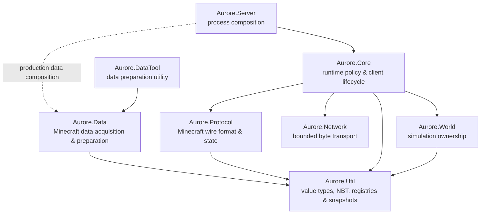

<div align="center">

# Aurore

### A modern C++ Minecraft server built from the wire up.

**Protocol-first · Explicit ownership · Bounded resources · Deterministic state**

[](https://github.com/ZettaBite4031/Aurore/actions/workflows/ci.yml)


[](LICENSE.txt)

**Windows x64 · Linux x86-64 · CMake-first**

*A ZettaTech Systems project.*

</div>

> [!WARNING]
> Aurore is not playable yet. It is active pre-alpha systems work, not a production Minecraft server.

> [!IMPORTANT]
> Aurore is an independent project. It is not an official Minecraft product and is not approved by or associated with Mojang Studios or Microsoft.

---

## The short version

Aurore is a from-scratch Minecraft-compatible server written in modern C++.

There is no vanilla server hiding underneath it and no large framework quietly doing the interesting parts. Networking, protocol state, registry synchronization, client lifecycle, world ownership, and eventually gameplay are being built as explicit systems with testable boundaries.

The current compatibility target is **Minecraft: Java Edition 1.21.11 / protocol 774**.

Aurore is being developed as a sequence of narrow vertical slices. The immediate goal is simple to describe and annoying in exactly the right way:

> **Make an unmodified vanilla client accept Aurore's Configuration state and enter Play.**

No chunks. No entities. No gameplay yet. First, the client has to believe our registry universe exists.

---

## Current frontier

```text
 HANDSHAKE          STATUS             LOGIN              CONFIGURATION                  PLAY
    READY             READY             READY              IN PROGRESS                   NEXT
      ●─────────────────●─────────────────●────────────────────◐──────────────────────────○
                                                                │
                                                    vanilla registry convergence
```

Aurore can currently:

- complete Handshake and Status with a vanilla-compatible client;
- complete offline Login and Core identity admission;
- enter Configuration and exchange Client Information and client brand data;
- send Feature Flags and negotiate Known Packs;
- defer registry materialization until the client's Known Packs response;
- send Registry Data, Update Tags, and clientbound Finish Configuration;
- retain one immutable registry generation for the lifetime of the Configuration exchange.

The current synthetic baseline intentionally stops at registry validation.

A Minecraft 1.21.11 client receives Aurore's synthetic dimension type, biome, and tag data, reaches `finish_configuration`, then rejects the registry set because the placeholder definitions are not valid vanilla definitions and several required synchronized registries are empty.

That failure is useful. It means the transport and Configuration lifecycle are reaching the expected boundary. The next work is data correctness, not another protocol rewrite.

---

## The data path

Aurore now has the machinery to obtain and prepare authoritative version-specific Minecraft data without baking Mojang data into the repository.

```text
        Mojang version metadata
                  │
                  ▼
        official server artifact
                  │
          SHA-1 verification
                  │
                  ▼
      Minecraft data generation
                  │
                  ▼
      validated local raw corpus
                  │
                  ▼
       VanillaDataImporter           ← next implementation milestone
                  │
                  ▼
       immutable RegistrySnapshot
                  │
                  ▼
     protocol-774 compatibility
             validation
                  │
                  ▼
        Configuration packets
```

`Aurore.DataTool` can exercise the raw preparation path independently of server startup. The importer that converts that corpus into a production registry snapshot is the current missing link.

The checked-in synthetic registry factory remains a deterministic regression fixture. It is not intended to resemble a complete vanilla dataset.

---

## System shape

Aurore is organized around ownership rather than convenience.



The dependency rule is intentionally uncomplicated:

> **Network moves bytes. Protocol understands Minecraft. Data prepares authoritative inputs. Core makes server decisions. World owns simulation. Server composes the process.**

| Project | Responsibility |
|---|---|
| `Aurore.Server` | Process entry point and top-level composition |
| `Aurore.Core` | Client lifecycle, identity, runtime policy, registry publication, and Play admission |
| `Aurore.Data` | Minecraft source acquisition, verification, generation, corpus validation, and future vanilla import |
| `Aurore.DataTool` | Standalone entry point for exercising the Minecraft data-preparation pipeline |
| `Aurore.Network` | Minecraft-agnostic transport, bounded queues, limits, and native backend lifecycle |
| `Aurore.Protocol` | Framing, packet codecs, protocol state, requests/resolutions, registry compatibility, and Configuration sequencing |
| `Aurore.Util` | Byte primitives, UUIDs, NBT, registries, tags, and immutable snapshots |
| `Aurore.World` | World ownership and explicit simulation/tick phases |
| `Aurore.Tests` | Unit, component, protocol, contract, backend, process, data, and loopback verification |

More detail lives in [Architecture](docs/ARCHITECTURE.md).

---

## What exists today

### Transport

Aurore has native **IOCP** and **epoll** network backends behind one Minecraft-agnostic transport contract. Connection lifecycle, queue limits, retained bytes, and failure behavior are explicit rather than left to an opaque networking framework.

### Protocol

Protocol 774 support currently covers the paths needed to reach the Configuration frontier:

```text
Handshake
├── Status
└── Login
    └── Configuration
        ├── Client Information
        ├── Custom Payload / client brand
        ├── Feature Flags
        ├── Known Packs
        ├── Registry Data
        ├── Update Tags
        └── Finish Configuration
```

Protocol code validates state and packet direction but does not decide whether a player should be admitted. Those decisions belong to Core.

### Registry model

Registry data is represented through immutable, generation-tracked snapshots.

The current model supports:

- typed domain registries;
- generic synchronized network registries;
- typed and generic tag sections;
- deterministic runtime-ID ordering;
- optional entry payloads;
- generation-local tag resolution;
- protocol-specific compatibility manifests;
- required/optional/forbidden entry and tag policies;
- minimum-entry and dependency validation.

A client sees one coherent snapshot for an entire Configuration exchange. It cannot observe a half-published registry update.

### Minecraft data preparation

`Aurore.Data` currently provides the foundations for version-specific vanilla data acquisition:

- official Mojang metadata and artifact resolution;
- optional local JAR sources;
- SHA-1 identity verification;
- Java runtime discovery;
- bounded child-process execution;
- Minecraft data/report generation;
- generated corpus validation and inspection.

The next layer is `VanillaDataImporter`, which will translate the generated corpus into Aurore's normalized registry model.

---

## Configuration: finish line

Configuration is considered complete when an unmodified Minecraft 1.21.11 client performs this sequence:

```text
client ── Handshake / Login ───────────────────────────────► Aurore

client ◄──────── Feature Flags / Select Known Packs ────── Aurore
client ─────────────── Known Packs selection ─────────────► Aurore

client ◄──────── Registry Data / Update Tags ───────────── Aurore
client ◄──────────── Finish Configuration ──────────────── Aurore

client ───────────── Finish Configuration ────────────────► Aurore

                         │
                         ▼

                 ProtocolState::Play
```

The remaining implementation path is intentionally narrow:

1. implement `VanillaDataImporter`;
2. import real dimension types and biomes;
3. populate the remaining required protocol-774 synchronized registries;
4. import and resolve vanilla tags;
5. complete the protocol-774 registry manifest;
6. make the imported snapshot the normal server bootstrap path;
7. iterate against vanilla until the client sends serverbound Finish Configuration.

At that point, **Configuration is done**.

The minimum Play bootstrap is a separate milestone.

---

## Build it

Aurore uses **CMake as the canonical build system**. Dependencies are pinned as Git submodules and participate directly in the project graph.

Clone with submodules:

```bash
git clone --recurse-submodules https://github.com/ZettaBite4031/Aurore.git
cd Aurore
```

### Windows

Baseline:

- Windows x64;
- Visual Studio 2026 with the MSVC v145 C++ workload;
- CMake 3.25 or newer;
- Git.

```powershell
cmake --preset windows-debug
cmake --build --preset windows-debug --parallel
ctest --preset windows-debug
```

The optional PowerShell wrapper provides the same workflow:

```powershell
./scripts/build.ps1 -Configuration Debug
```

### Linux

Baseline:

- x86-64 Linux;
- CMake 3.25 or newer;
- Ninja;
- a sufficiently complete C++23 GCC or Clang toolchain;
- Git.

```bash
cmake --preset linux-debug
cmake --build --preset linux-debug --parallel
ctest --preset linux-debug
```

Or:

```bash
./scripts/build.sh Debug
```

Release presets and the complete development workflow are documented in [Development](docs/DEVELOPMENT.md).

> [!NOTE]
> A Java runtime is not required to build Aurore itself. It is required when using the Minecraft raw-data preparation pipeline.

---

## First Light

**First Light** remains Aurore's first end-to-end server milestone, but Configuration convergence comes first.

First Light begins once a vanilla client can enter Play. From there, the goal is deliberately tiny: establish the minimum valid Play bootstrap, keep one player synchronized in one small world context, and disconnect cleanly.

Broad chunk generation, entity systems, inventory, commands, persistence, online authentication, compression, and a public mod API are not prerequisites unless the minimum client path proves otherwise.

Aurore grows by making one path real before widening it.

See the [Roadmap](docs/ROADMAP.md) for the broader milestone structure.

---

## Engineering character

Aurore deliberately favors:

- explicit ownership over shared mutable state;
- deterministic publication over partially visible mutation;
- bounded resources over invisible growth;
- typed boundaries over implicit subsystem coupling;
- visible execution order over callback fog;
- measured abstractions over speculative frameworks;
- tests at subsystem boundaries, not only inside individual classes.

Performance matters, but understandable ownership and predictable behavior come first. Fast nonsense is still nonsense.

---

## The eventual Aurore client

The Aurore name is intended to cover two related products:

| Product | Direction |
|---|---|
| **Aurore Server** | The C++ server runtime being developed in this repository |
| **Aurore Client** | A future custom client focused on performance, rendering, interface design, accessibility, and modding |

They share a product identity, not a runtime or executable.

The client has not been started. It stays that way until the server has something worth connecting to.

---

## Documentation

| Document | Covers |
|---|---|
| [Architecture](docs/ARCHITECTURE.md) | Subsystem ownership, dependencies, and runtime flow |
| [Development](docs/DEVELOPMENT.md) | Toolchains, CMake presets, testing, dependencies, and workflow |
| [Protocol and data](docs/PROTOCOL_AND_DATA.md) | Protocol boundaries, registry/data contracts, and compatibility work |
| [Roadmap](docs/ROADMAP.md) | Vertical slices, First Light, and future direction |
| [Legal and provenance](docs/LEGAL_AND_PROVENANCE.md) | Clean implementation and data provenance boundaries |
| [Contributing](CONTRIBUTING.md) | Contribution expectations |
| [Third-party notices](THIRD_PARTY_NOTICES.md) | Dependency provenance and pinned third-party components |

---

## License

Aurore-authored source and documentation are available under the [MIT License](LICENSE.txt).

Dependencies, Minecraft, Mojang Studios, Microsoft, and other third-party names and materials remain subject to their respective terms.
