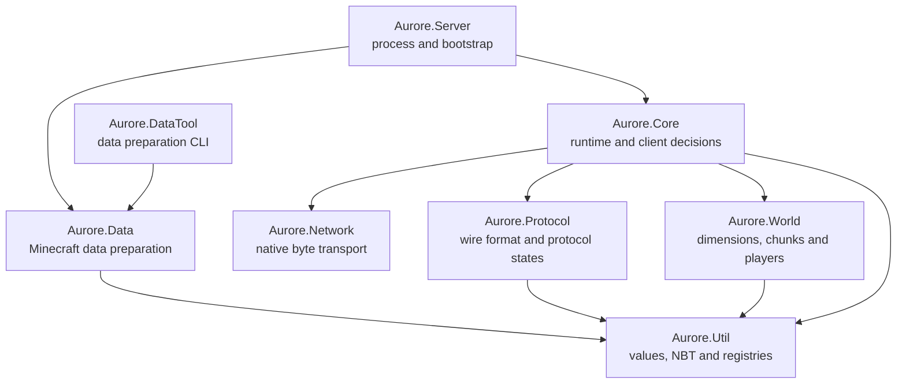

# Architecture

Aurore is organized around **who owns a decision**. A server has enough moving parts without making every subsystem understand everything else.

This document describes the First Light implementation, not a hypothetical finished Minecraft engine.

## System map



| Owner | Responsible for | Not responsible for |
|---|---|---|
| Server | Startup, production registry preparation, configuration, tick-loop composition | Packet decoding, socket details |
| Core | Connection and player lifecycle, policy, login admission, timeouts, synchronization coordination | Raw packet encodings, platform I/O |
| Network | IOCP/epoll transport, connection handles, event/command queues, byte limits | Minecraft packet IDs or game rules |
| Protocol | Frames, state transitions, codecs, requests and resolutions, registry/configuration compatibility | Admission policy or sockets |
| Data | Source identity, downloads, process execution, cache and corpus validation, vanilla data import | Live player state |
| World | Dimensions, sparse chunks, players, positions, tick order | Framing or network operations |
| Util | Byte buffers, UUID, resource locations, NBT, registry abstractions, immutable snapshots | Application policy |

Tests can use explicit internal test-access points when necessary. Those aren't invitations to loosen production ownership boundaries.

## Server startup

1. `Aurore.Server` prepares or reuses the Minecraft 1.21.11 generated-data corpus.
2. `Aurore.Data` validates the corpus and imports it into an immutable `RegistrySnapshot`.
3. `Core::Server` initializes logging, configuration, the registry store, Configuration policy, client management, and World.
4. The native network backend starts accepting connections once the required authoritative data is ready.
5. The server thread drives network event processing, timeout handling, and ordered ticks.

The checked-in synthetic registry factory is for deterministic tests. Normal production startup supplies the imported vanilla registry snapshot to Core.

## Client lifecycle

The transport publishes events, not gameplay callbacks. `ClientService` processes them on the server thread, owns the `ConnectionManager`, asks `ProtocolConnection` to parse incoming bytes, and applies policy to typed requests.

```text
native socket
   ↓
NetworkManager event queue
   ↓
ClientService on server thread
   ↓
ClientConnection / ProtocolConnection
   ↓
typed requests + protocol output
   ↓
Core policy, World state, queued response frames
```

Handshake chooses Status or Login. Offline Login creates a provisional identity, and Configuration negotiates feature flags, known packs, registries, and tags. Core admits a player only after both protocol and lifecycle state agree on Play.

In First Light, Core then creates a World player, sends the initial Play bootstrap, transfers a lit 3×3 chunk neighborhood, and tracks the client's teleport acknowledgement, chunk-batch feedback, and loaded notification. Real server-issued keepalives, connection idle timeouts, and synchronization deadlines protect the session. Closing a connection releases its player and associated tracker state.

### Authority and failure isolation

Network workers own I/O completion, not game policy. Core owns the client collection and changes it from the server thread. Malformed frames, unexpected packets, invalid feedback, failed sends, and disconnected peers are handled using explicit dispositions and close causes.

Untrusted buffers, queued bytes, client counts, and protocol structures have limits. Receive events hold resource credit until Core drains them. Graceful closure preserves pending output order when possible; immediate closure can discard work according to the transport contract.

## Registry generations and the data boundary

Data builds complete validated snapshots and publishes them atomically. A Configuration session retains one generation for its entire exchange; it cannot accidentally mix old and new tag or registry contents.

The protocol-774 compatibility manifest determines which registry sections are required and how data is represented on the wire. Mojang's source JSON is contained within `Aurore.Data`; the rest of the runtime consumes normalized models.

See [Protocol and Data](PROTOCOL_AND_DATA.md) for the detailed generation and import path.

## First Light world

`WorldManager` has built-in Overworld, Nether, and End dimension objects, with a place to register custom dimensions. Only the Overworld currently contains the First Light platform: a 5×5 patch of grass, dirt, and stone in chunk `(0, 0)`, with a fixed spawn near its center.

The world stores sparse chunks. Neighboring empty columns are serialized when needed for the vanilla client's lighting and terrain readiness, without permanently allocating a complete world. The initial transfer consists of nine columns. This is *not* procedural generation or a chunk-streaming system.

Player objects retain their identity, dimension, position, and loaded state. Movement updates are decoded and applied. The majority of tick phases are deliberate placeholders; they do not yet simulate block ticks, entities, weather, raids, or other gameplay.

## Ticks and order

Aurore's long-term goal is high performance **without silently breaking compatibility-sensitive ordering**. Tick stages are explicit rather than hidden in an arbitrary event registry. Dimension tick order is Overworld, Nether, End, and then registered custom dimensions. Many phases currently have no behavior, but their positions make future design decisions visible.

Optimization must preserve required behavior, or be an explicit documented mode with tests that demonstrate the tradeoff. Parallel execution is a future question, not a First Light claim.

## When extending a subsystem

Ask three questions: Which layer owns the state? At what point can it change authoritatively? How will an integration test notice when it breaks?

If a new concept crosses a boundary, prefer a small typed request or value over reaching directly into another subsystem's internals. For practical build and testing instructions, see [Development](DEVELOPMENT.md).
